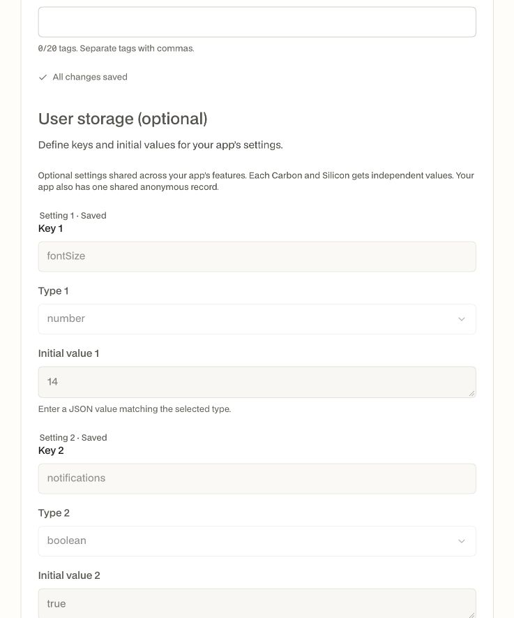

# User storage verification — 8 November 2026

Implemented and verified locally across Silicon Apps and the Silicon Accounts developer portal. No production deployment or public release was performed.

## Environment

- Isolated Accounts database `apps_storage_e2e_9740` with synthetic test accounts.
- Real local Accounts API on port 9739, Accounts site on 9740, developer portal on 9745, and Apps API on 9746.
- Apps development authentication disabled. Runtime requests used real Accounts-issued User verification and App verification proofs, verified by the `silicon-apps` recipient.
- Apps used its own SQLite database under the isolated local stack. No existing user login or production data was used.

## Manual browser checks

1. Signed into the developer portal as the synthetic Storage QA account.
2. Created `storage-manual-qa` using the optional storage editor with a string setting and a boolean setting.
3. Entered an invalid boolean default, confirmed validation refused it, then corrected it and created the app.
4. Opened Publishing → Details, added `fontSize` with numeric default 14, and saved the definition through the real portal BFF and Apps API.
5. Reloaded the page and confirmed all three saved keys, types and initial values persisted and were locked against destructive edits.
6. Repeated the reload after restarting the final Apps binary; the definition remained intact.

## Real Accounts, API and CLI checks

Thirty scripted end-to-end checks exercised the running local services and the built CLI/Rust client:

- Create with a schema; create with storage omitted; define storage later; retrieve the schema.
- Cross-app read of the authorized user's complete settings; rejection for a different user.
- Owner writes with both proofs; rejection of user-proof-only writes, another app's proof and read-only authorization.
- Independent signed-in users, separate apps and the shared per-app `anon` record.
- Typed validation, unknown-key rejection, partial updates, selected-key reset, stale revision rejection and idempotent retries.
- CLI reads/writes/resets, private proof files and proof input through stdin.
- Immediate rejection after revocation and rejection of a real expired proof.

After restarting the final server build, an additional verification confirmed the signed-in user's values and revision 5, anonymous values and revision 3, continued rejection of revoked/expired proofs, and `Cache-Control: private, no-store`.

## Automated checks

| Check | Result |
| --- | --- |
| Apps `cargo test --workspace --no-fail-fast` | 136 passed, 0 failed, 1 ignored |
| Apps server and CLI development builds | Passed |
| CLI experience tests after final docs command correction | 7 passed; `docs storage` also checked directly |
| Developer portal `pnpm test` | 95 passed |
| Developer portal storage Playwright tests | 2 passed |
| Developer portal `pnpm typecheck` | Passed |
| Developer portal `pnpm lint` | Passed |
| Developer portal `pnpm build` | Passed |
| Whitespace validation in both repositories | Passed |

The ignored Rust test is the existing UUID-cutover fixture generator, which requires a separately configured Accounts token and empty fixture directory. Storage tests were all executed, including concurrency, atomic schema validation, quota enforcement when adding defaults, persistence, authorization and revoked idempotent replays.

The isolated test stack was stopped after verification. Its test data was retained locally; shared PostgreSQL and other development stacks were left running.

## Deployment considerations

Runtime verification needs the Apps service's own `APPS_ACCOUNTS_APP_SECRET`; missing configuration fails closed with 503. Existing schema keys, types and defaults are immutable; authors can append new keys. These rules and the API/CLI examples are documented in [App user storage](user-storage.md).
